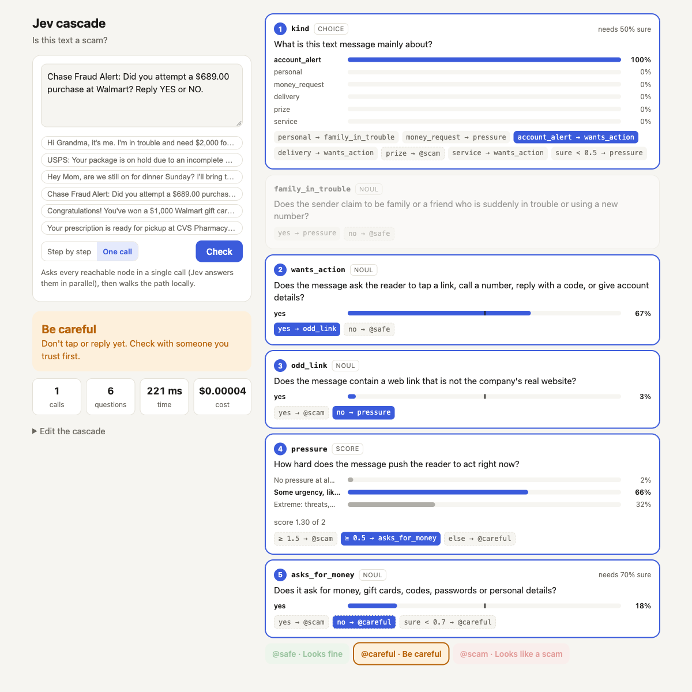
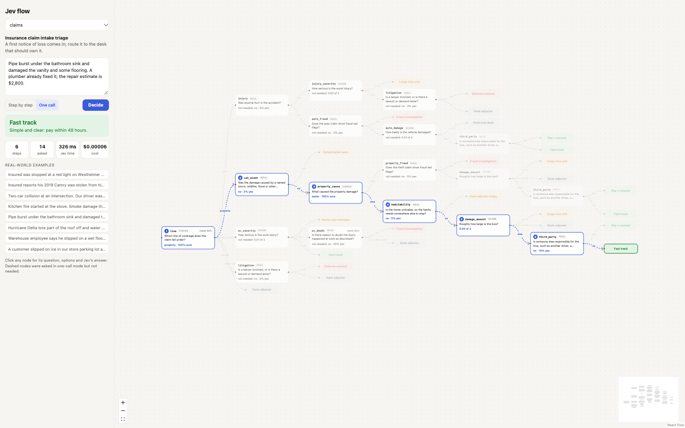
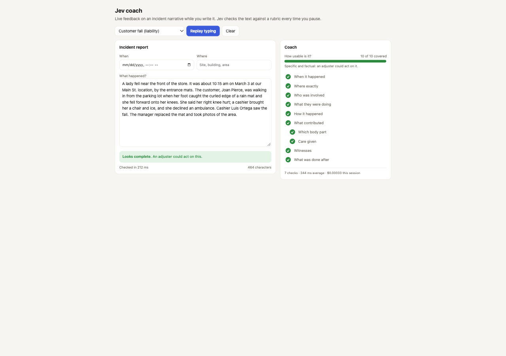

# Demo gallery

Small AI experiments, each in its own folder and runnable on its own. Some are useful, some are just fun.

## Jev demos

[Jev](https://openrouter.ai/docs/guides/community/jev-tutorial) (TypeSafe's `typesafe/jev-1.13`) is a decision
model: instead of writing text it answers typed questions (pick one of these, yes/no, score on this scale) with
calibrated probabilities, in about 200 ms, for fractions of a cent. These demos call it through OpenRouter.

Each one is plain Node (18+) with no dependencies: a tiny server that keeps your OpenRouter key on your machine, and a
single page.

```
cd jev-flow                                  # or jev-cascade, jev-coach
OPENROUTER_API_KEY=sk-or-… node server.js    # or: node server.js --env path/to/.env
node test.js                                 # each engine against a fake Jev, no key needed
```

### [jev-cascade](jev-cascade): is this text a scam?

A cascade of small Jev questions (what kind of message, is it pushing urgency, does the link look fake, does it ask for
money) that ends in *Looks fine*, *Be careful* or *Looks like a scam*. Shaky answers are routed somewhere safer, and the
whole cascade is editable JSON. Compares asking one question per call with asking all of them in one call.



### [jev-flow](jev-flow): insurance claim triage as a decision tree

A first notice of loss goes through up to 14 typed questions (coverage line, injury, severity, fraud red flags,
catastrophe, habitability, loss size, litigation) to one of 10 desks, drawn as a React Flow tree that lights up as Jev
answers. Eight realistic example claims; asking every question in one call is about 3.5× faster for the same cost.



### [jev-coach](jev-coach): live coaching on a narrative field

An incident report's "What happened?" box with a checklist that fills in as you type: when, where, who, what they were
doing, how it happened, what contributed, witnesses, what was done after, plus injury follow-ups and a blame-language
warning. Jev only says what's missing; it never writes for the author. Press *Replay typing* to watch a weak draft
improve.



## License

MIT
